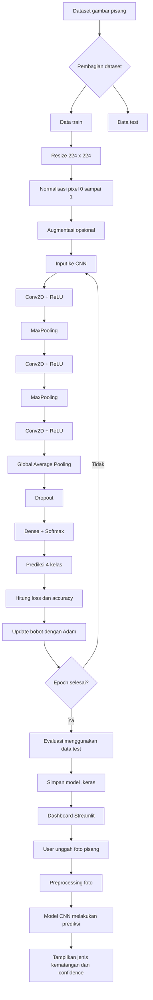

# Flowchart Proses CNN BananaSense

## Alur utama

## Kelas keluaran

| Jenis | Tingkat kematangan |
|---|---|
| Semua citra pisang | Mentah, setengah matang, matang, terlalu matang |

## Ringkasan proses

1. Gambar pada `data/train/` digunakan untuk mempelajari pola warna, tekstur, dan bentuk.
2. CNN mengekstrak fitur melalui lapisan convolution dan pooling.
3. Lapisan `Dense + Softmax` memilih satu dari empat kelas.
4. Bobot model diperbarui berulang kali selama beberapa epoch.
5. `data/test/` mengukur kemampuan model pada gambar yang belum dipelajari.
6. Model tersimpan di `models/bananasense.keras` dan digunakan oleh dashboard.

> Catatan: struktur dataset saat ini mengelompokkan gambar berdasarkan tingkat kematangan. Jika jenis Cavendish dan Ambon juga ingin menjadi label terpisah, gunakan subfolder `jenis/tingkat_kematangan` di dalam `train/` dan `test/`.
