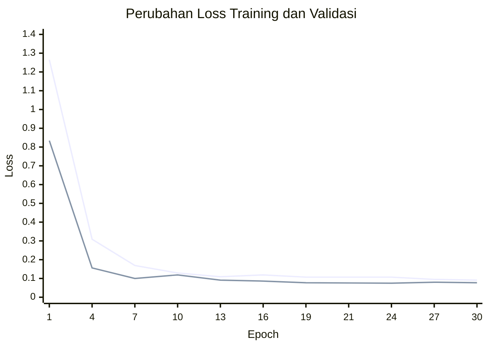
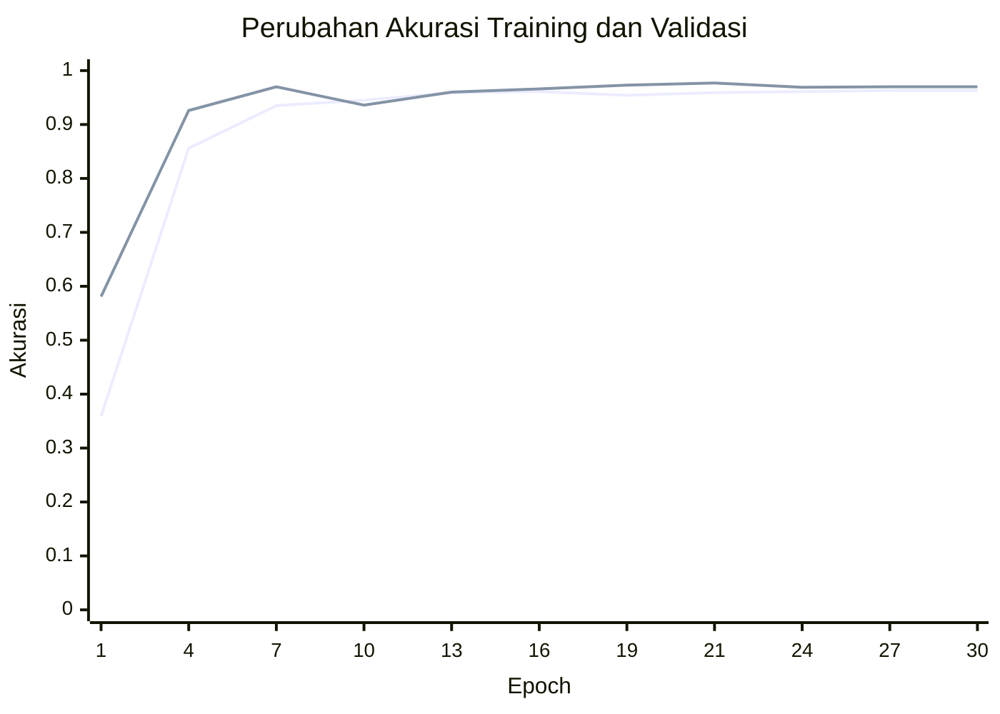

# Laporan Proyek BananaSense

## 1. Identitas Proyek

**BananaSense** adalah aplikasi klasifikasi tingkat kematangan pisang menggunakan Convolutional Neural Network (CNN) berbasis citra digital. Aplikasi membedakan empat kelas kematangan:

1. `mentah`
2. `setengah-matang`
3. `matang`
4. `terlalu-matang`

Sistem terdiri dari model CNN, backend FastAPI, dan dashboard Next.js. Pengguna dapat mengunggah gambar `PNG`, `JPG`, `JPEG`, atau mengambil gambar melalui kamera.

## 2. Tujuan

- Mengklasifikasikan tingkat kematangan pisang secara otomatis.
- Menyediakan dashboard sederhana untuk upload gambar dan kamera.
- Menampilkan confidence setiap kelas.
- Menampilkan proses training, loss, akurasi, gradient norm, learning rate, dan epoch terbaik.
- Menyediakan arsitektur yang dapat dideploy menggunakan Hugging Face, Render, dan Vercel.

## 3. Struktur Proyek

```text
Banana Sense/
├── backend/
│   ├── api.py                 # REST API FastAPI
│   └── README.md
├── data/
│   ├── train/                 # Data training milik pengguna
│   └── test/                  # Data pengujian milik pengguna
├── docs/
│   ├── flowchart-cnn.md
│   └── laporan-proyek.md
├── frontend/
│   ├── app/page.tsx           # Dashboard Next.js
│   ├── app/globals.css        # Tampilan responsif
│   └── package.json
├── models/                    # Artefak model, dihasilkan setelah training
├── scripts/
│   ├── check_dataset.py
│   └── upload_huggingface.py
├── src/bananasense/
│   ├── data.py                # Baca dan split dataset
│   ├── model.py               # Arsitektur CNN
│   ├── train.py               # Training dan penyimpanan artefak
│   ├── evaluate.py            # Evaluasi model
│   └── predict.py             # Prediksi satu gambar
├── render.yaml
├── requirements.txt
└── README.md
```

## 4. Dataset

Dataset menggunakan struktur folder berdasarkan label. Data tidak disediakan oleh aplikasi dan harus dimasukkan sendiri ke folder `data/`.

```text
data/
├── train/
│   ├── mentah/
│   ├── setengah-matang/
│   ├── matang/
│   └── terlalu-matang/
└── test/
    ├── mentah/
    ├── setengah-matang/
    ├── matang/
    └── terlalu-matang/
```

Distribusi dataset pada eksperimen terakhir:

| Kelas | Train | Test |
|---|---:|---:|
| Mentah | 392 | 99 |
| Setengah matang | 484 | 122 |
| Matang | 235 | 59 |
| Terlalu matang | 379 | 95 |
| **Total** | **1.490** | **375** |

Sebanyak 20% dari data `train` digunakan sebagai validation set menggunakan **stratified split**. Data `test` tidak digunakan selama training sehingga tetap menjadi evaluasi akhir.

## 5. Metode CNN

Alur pemrosesan gambar:

```mermaid
flowchart LR
    A[Citra pisang] --> B[Resize 160 x 160]
    B --> C[Normalisasi nilai piksel]
    C --> D[Augmentasi training]
    D --> E[Conv2D + ReLU]
    E --> F[MaxPooling]
    F --> G[Conv2D + ReLU]
    G --> H[MaxPooling]
    H --> I[Conv2D + ReLU]
    I --> J[Global Average Pooling]
    J --> K[Dropout]
    K --> L[Dense Softmax]
    L --> M[Prediksi 4 kelas]
```



Model menggunakan beberapa blok convolution dan max pooling untuk mengambil pola warna, tekstur, bentuk, serta bintik pada kulit pisang. Lapisan `GlobalAveragePooling2D`, `Dropout`, dan `Dense Softmax` digunakan untuk menghasilkan probabilitas empat kelas.

## 6. Gradient Descent

Bobot model diperbarui menggunakan rumus:

```text
θ(t+1) = θ(t) − η × ∇J(θ(t))
```

Keterangan:

- `θ(t)`: bobot model pada iterasi saat ini.
- `η`: learning rate.
- `∇J(θ(t))`: gradient loss terhadap bobot.
- `θ(t+1)`: bobot setelah diperbarui.

Gradient norm dicatat setiap epoch. Grafik gradient norm dapat naik-turun karena bobot diperbarui pada setiap batch. Hal tersebut normal selama loss cenderung menurun dan akurasi validasi membaik.

## 7. Hasil Training Terakhir

Hasil berikut diambil dari `models/metrics.json` setelah eksperimen 30 epoch:

| Metrik | Hasil |
|---|---:|
| Epoch selesai | 30 |
| Epoch terbaik | **21** |
| Validation accuracy terbaik | **97,65%** |
| Validation loss terbaik | **0,0759** |
| Test accuracy | **97,87%** |
| Test loss | **0,0611** |

### Grafik Training

Grafik berikut adalah ringkasan nilai per beberapa epoch dari `training_history.json`. Dashboard menampilkan seluruh epoch secara interaktif.



Garis pertama adalah loss training dan garis kedua adalah validation loss. Secara umum keduanya turun dari awal hingga akhir training.



Epoch 21 dipilih sebagai epoch terbaik karena menghasilkan `val_accuracy` tertinggi, yaitu 97,65%. Bobot terbaik dipulihkan menggunakan `restore_best_weights=True`.

### Classification Report

| Kelas | Precision | Recall | F1-score | Jumlah test |
|---|---:|---:|---:|---:|
| Mentah | 100,00% | 100,00% | 100,00% | 99 |
| Setengah matang | 99,19% | 100,00% | 99,59% | 122 |
| Matang | 93,22% | 93,22% | 93,22% | 59 |
| Terlalu matang | 96,81% | 95,79% | 96,30% | 95 |
| **Macro average** | **97,30%** | **97,25%** | **97,28%** | **375** |

Kesalahan paling banyak terjadi pada kelas `matang` dan `terlalu-matang`, karena keduanya memiliki kemiripan warna dan bintik pada kulit pisang.

### Matthews Correlation Coefficient (MCC)

Evaluasi model juga menggunakan **MCC**. Untuk klasifikasi empat kelas, sistem menghitung MCC multiclass sebagai nilai macro keseluruhan dan MCC one-vs-rest untuk setiap kelas. MCC dipilih karena mempertimbangkan true positive, true negative, false positive, dan false negative sehingga lebih informatif ketika jumlah data antar kelas tidak sama.

Interpretasi MCC:

| Nilai | Interpretasi |
|---:|---|
| 1 | Prediksi sempurna |
| 0 | Prediksi setara dengan tebakan acak |
| -1 | Prediksi berlawanan dengan label aktual |

Nilai MCC dan MCC per kelas tersimpan di `models/metrics.json` pada bagian `mcc`, lalu ditampilkan pada halaman Admin di route `/admin`.

## 8. Instalasi dan Menjalankan Training

Buka PowerShell pada root project:

```powershell
cd "C:\Semester5-SDT\Banana Sense"
python -m venv .venv
.venv\Scripts\Activate.ps1
pip install -r requirements.txt
```

Cek distribusi data:

```powershell
python scripts/check_dataset.py
```

Jalankan training dengan konfigurasi yang aman untuk CPU Windows:

```powershell
$env:TF_ENABLE_ONEDNN_OPTS="0"
$env:TF_NUM_INTRAOP_THREADS="2"
$env:TF_NUM_INTEROP_THREADS="2"
.venv\Scripts\python.exe -m src.bananasense.train --epochs 30 --batch-size 16
```

Training menghasilkan:

- `models/bananasense.keras`
- `models/metrics.json`
- `models/training_history.json`
- `models/confusion_matrix.json`
- `models/class_names.json`

## 9. Menjalankan Aplikasi Lokal

### Terminal 1 — Backend FastAPI

```powershell
cd "C:\Semester5-SDT\Banana Sense"
.venv\Scripts\Activate.ps1
$env:FRONTEND_ORIGIN="http://localhost:3001"
uvicorn backend.api:app --reload --host 127.0.0.1 --port 8017
```

Tes backend:

```powershell
curl.exe http://127.0.0.1:8017/api/health
```

### Terminal 2 — Frontend Next.js

```powershell
cd "C:\Semester5-SDT\Banana Sense\frontend"
npm install
npm run dev
```

Buka dashboard:

```text
http://localhost:3001
```

### Dua tampilan frontend

- `/` atau `http://localhost:3001`: halaman User dengan splash screen, upload gambar, kamera, prediksi, dan confidence.
- `/admin` atau `http://localhost:3001/admin`: halaman Admin dengan dataset, classification report, MCC macro, MCC per kelas, confusion matrix, grafik loss, dan gradient descent.

Kedua halaman memiliki tombol mode **Terang/Gelap**.

Tes prediksi dari PowerShell:

```powershell
curl.exe -X POST `
  -F "file=@C:\Semester5-SDT\Banana Sense\sample-images\sample-v2-matang.png" `
  http://127.0.0.1:8017/api/predict
```

## 10. Hugging Face, Render, dan Vercel

### Upload model ke Hugging Face

```powershell
cd "C:\Semester5-SDT\Banana Sense"
$env:HF_TOKEN="hf_token_kamu"
python scripts/upload_huggingface.py `
  --repo-id username/bananasense-cnn `
  --token $env:HF_TOKEN
```

### Backend di Render

Gunakan konfigurasi pada `render.yaml`:

```text
Build Command : pip install -r requirements.txt
Start Command : uvicorn backend.api:app --host 0.0.0.0 --port $PORT
```

Environment variables Render:

```text
HF_REPO_ID=username/bananasense-cnn
HF_MODEL_FILENAME=bananasense.keras
HF_TOKEN=hf_token_kamu
FRONTEND_ORIGIN=https://nama-project.vercel.app
```

### Frontend di Vercel

- Import repository GitHub.
- Set **Root Directory** menjadi `frontend`.
- Pilih framework `Next.js`.
- Tambahkan environment variable:

```text
NEXT_PUBLIC_API_URL=https://nama-backend.onrender.com
```

Setelah deployment Vercel selesai, masukkan URL Vercel ke `FRONTEND_ORIGIN` di Render kemudian redeploy backend.

## 11. Pengujian Fungsional

| Fitur | Cara pengujian | Hasil yang diharapkan |
|---|---|---|
| Health check | `GET /api/health` | Status `ok` |
| Metrics | `GET /api/metrics` | Metrik training tersedia |
| Upload PNG | Pilih gambar `.png` | Preview dan prediksi muncul |
| Upload JPG/JPEG | Pilih gambar `.jpg` atau `.jpeg` | Preview dan prediksi muncul |
| Kamera | Klik **Gunakan kamera** | Kamera browser terbuka |
| Prediksi | Klik **Analisis kematangan** | Label dan confidence tampil |
| Grafik | Buka bagian training | Loss, akurasi, dan gradient tampil |

## 12. Catatan dan Batasan

- Akurasi model sangat bergantung pada kualitas serta variasi data pengguna.
- Gambar dengan pencahayaan rendah, objek pisang terlalu kecil, atau latar yang ramai dapat menurunkan confidence.
- Gambar contoh pada `sample-images/` hanya digunakan untuk uji dashboard, bukan pengganti dataset training.
- Folder `models/` tidak wajib disimpan di GitHub jika model sudah diunggah ke Hugging Face.
- Jangan menyimpan `HF_TOKEN` di source code atau repository publik.

## 13. Ringkasan Kesimpulan

BananaSense berhasil mengklasifikasikan empat tingkat kematangan pisang dengan test accuracy 97,87% pada eksperimen terakhir. Epoch terbaik berada pada epoch 21 dengan validation accuracy 97,65%. Sistem siap digunakan secara lokal melalui FastAPI dan Next.js, serta dapat dideploy dengan model dan metadata yang disimpan di Hugging Face.
